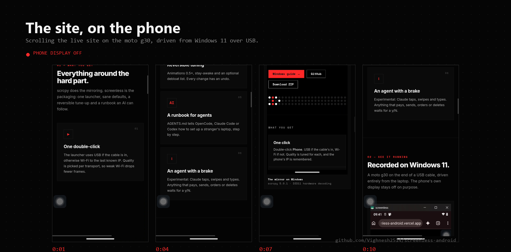
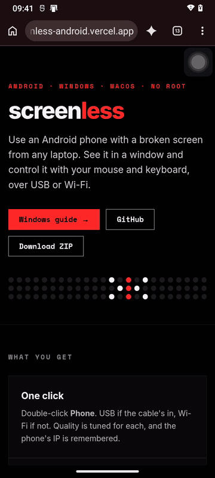
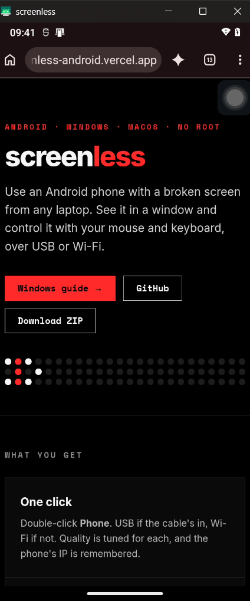
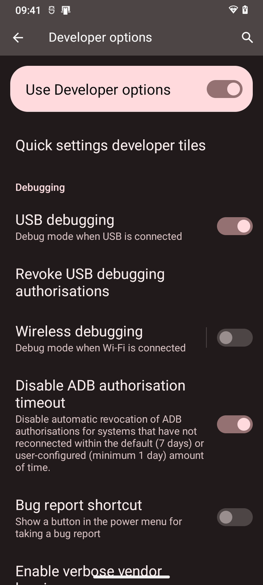
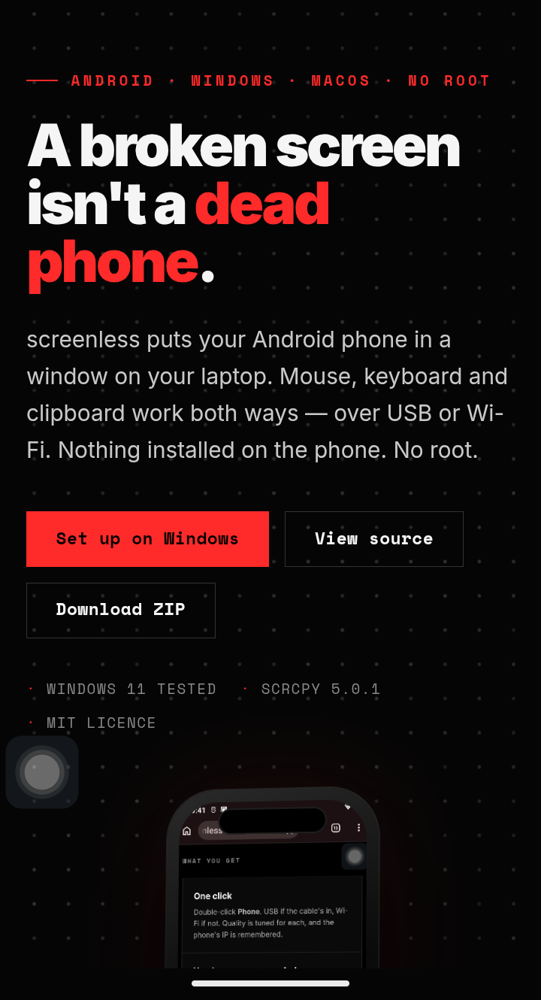
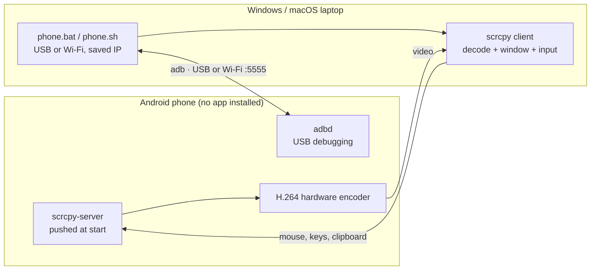
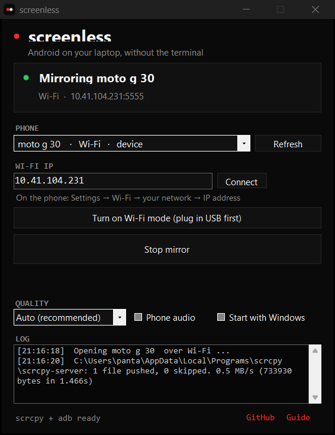

<div align="center">

# screenless

**Use an Android phone with a broken screen from any Windows or Mac laptop.**<br>
See it in a window, control it with your mouse and keyboard, over USB or Wi-Fi.
No root. No app on the phone.


**[Windows guide →](docs/WINDOWS.md)** &nbsp;·&nbsp; [Website](https://screenless-android.vercel.app) &nbsp;·&nbsp; [macOS guide](docs/MACOS.md) &nbsp;·&nbsp; [Troubleshooting](docs/TROUBLESHOOTING.md)

<a href="site/media/filmstrip.png"></a>

</div>

> Built by **[Vighnesh2514](https://github.com/Vighnesh2514)** with **Claude** (Anthropic's AI). My moto g30's display died but the phone still worked. I set the direction and made the calls; Claude did the diagnosis, measurements, scripts and docs.

## Contents

- [Why this exists](#why-this-exists)
- [Demo](#demo)
- [Screenshots](#screenshots)
- [What you get](#what-you-get)
- [Desktop app](#desktop-app-no-terminal)
- [How it works](#how-it-works)
- [Quick start (Windows)](#quick-start-windows)
- [Results](#results)
- [Repository layout](#repository-layout)
- [Compatibility and limits](#compatibility-and-limits)
- [Security](#security)
- [Troubleshooting](#troubleshooting)
- [FAQ](#faq)
- [Roadmap](#roadmap)
- [Credits and licences](#credits-and-licences)

## Why this exists

My Motorola moto g30 had a problem worse than a smashed screen: a half-working one. The display glitched, touches landed in the wrong places, and some days it barely responded. Everything inside still worked — WhatsApp, the camera, my apps, my data. I just couldn't reliably use any of it.

The usual answers are a screen replacement or a new phone. I wanted a third option: **use the phone fully from a laptop**. See its screen in a window, tap with the mouse, type with the keyboard, and never touch the broken panel again.

This is not reverse engineering. It runs on two open, official pieces:

- **[adb](https://developer.android.com/tools/adb)** — Google's own debugging channel into every Android phone.
- **[scrcpy](https://github.com/Genymobile/scrcpy)** — Genymobile's excellent open-source mirroring engine.

What this project adds is everything around them: a one-click launcher, wireless mode that survives, tuning for a slow 4 GB phone, a Windows kit that needs no admin rights, a runbook written for AI agents, and an experimental agent that can operate the phone itself.

## Demo



**11-second recording** — [watch the MP4](site/media/demo.mp4) (1 MB). The phone's own display is off the whole time; every tap and swipe came from the laptop.

Recorded on Windows 11 with a moto g30 over USB, using scrcpy `--record`.

## Screenshots

| The mirror on Windows | USB debugging, once | This site, on the phone |
|---|---|---|
|  |  |  |

All captured on the real moto g30, driven from a Windows 11 laptop over USB.

## What you get

| | What it does |
|---|---|
| **One-click launcher** | Double-click **Phone** on the Desktop. It uses USB if the cable is in, otherwise Wi-Fi to the last known IP, and picks the right quality for each. |
| **Works without the phone's screen** | Mouse, keyboard, clipboard and pattern unlock all work from the laptop. The phone's damaged display stays off, saving battery and the panel. |
| **Wireless that survives** | Run it once over USB and it switches the phone into wireless mode. Plug in again after a restart and it re-arms itself. |
| **Move between laptops** | Copy the phone's trusted `adbkey` pair to a friend's laptop and the phone accepts it immediately, with no "Allow?" prompt on a screen you can't see. |
| **Speed tuning** | `tune.ps1` speeds up animations, keeps the phone awake and disables bloatware. Every change is reversible with `-Undo`. |
| **No admin, no Store** | The Windows installer downloads the official scrcpy build into `%LOCALAPPDATA%\Programs\scrcpy` and adds it to your user PATH. |
| **AI setup runbook** | [AGENTS.md](AGENTS.md) lets OpenCode, Claude Code or Codex set up a new laptop end to end, with an expected output for every step. |
| **Phone agent** *(experimental)* | Claude reads the screen, taps, swipes and types. Anything that pays, sends, orders, deletes or submits an OTP waits for a y/N. [agent/](agent/) |
| **Doctor script** | `windows\doctor.ps1` checks scrcpy, adb, the saved IP, the connected phone and the shortcut without starting a mirror. |

## How it works



- **Nothing is installed on the phone.** scrcpy pushes a small server over adb each time it starts and removes it when you stop.
- **Trust is a key pair.** When you tap *Always allow*, the phone stores the laptop's adb public key. Copying `adbkey` + `adbkey.pub` to another laptop makes it trusted too.
- **Wireless** is `adb tcpip 5555` while plugged in, then `adb connect <ip>:5555`. Android resets it on every reboot.

## Desktop app (no terminal)

**Download [screenless.exe](https://github.com/Vighnesh2514/screenless-android/releases/latest/download/screenless.exe)** and double-click it. No PowerShell, no OpenCode, no setup.

- Plug in USB → press **Turn on Wi-Fi mode** → unplug → **Start mirror**
- Or type the phone's IP → **Connect** → **Start mirror**
- Lives in the tray, can start with Windows, and installs scrcpy on first run if it's missing



Built with the C# compiler that ships with Windows: one 62 KB `.exe`, no installer, no admin rights. Source: [app/](app/).

## Quick start (Windows)

You need Windows 10/11, an Android 5+ phone with **USB debugging on** ([how](docs/WINDOWS.md#step-1--turn-on-usb-debugging-on-the-phone)), and a USB data cable for the first connection.

```powershell
git clone https://github.com/Vighnesh2514/screenless-android C:\screenless
cd C:\screenless\windows
powershell -ExecutionPolicy Bypass -File .\install.ps1     # scrcpy + a "Phone" Desktop shortcut
powershell -ExecutionPolicy Bypass -File .\doctor.ps1      # optional: check tools, phone and saved IP
```

Plug in the phone, double-click **Phone** and tap **Allow** once. To go wireless, unplug and double-click **Phone** again.

Full walkthrough, every setting explained: **[docs/WINDOWS.md](docs/WINDOWS.md)**.

> [!TIP]
> Phone restarted and Wi-Fi stopped working? That's Android turning wireless mode off. Plug in, start **Phone** once, unplug. [Why, and how to automate it](docs/WIRELESS.md).

## Results

Measured on a Motorola moto g30 (Snapdragon 662, 4 GB RAM, Android 12, 720×1600 @ 60 Hz). Details: [docs/PERFORMANCE.md](docs/PERFORMANCE.md).

| | Before | After | What changed |
|---|---:|---:|---|
| Free RAM | 650 MB | **860 MB** | Disabled 12 background bloat apps |
| Free RAM (Windows run) | 887 MB | **1,558 MB** | Same tune-up, measured again after the port |
| Animation speed | 1.0× | **0.5×** | Screens open about twice as fast |
| Mirror goes black on Wi-Fi | Yes | **No** | Stay-awake that works without charging |
| Wi-Fi ping (2.4 GHz hotspot) | 166 ms avg, 690 ms peak | — | Network-bound; the fix is 5 GHz or USB, not a setting |

The biggest finding: **on a 4 GB phone, the lag is RAM and Wi-Fi, not the mirroring.** scrcpy streams through the phone's hardware H.264 encoder, so other mirroring apps can't beat it. They either wrap scrcpy or add latency.

## Repository layout

```
windows/
  install.ps1     One-time setup: scrcpy, optional trusted key, Desktop shortcut
  phone.ps1       Launcher: USB or Wi-Fi, saved IP, tuned quality
  phone.bat       Double-click wrapper for phone.ps1
  tune.ps1        Animations, stay awake, optional debloat (all reversible)
  doctor.ps1      Checks tools, phone and saved IP without mirroring
  _common.ps1     Shared helpers: tool lookup, adb parsing, retries
macos/
  phone.sh        Same launcher for macOS
debloat/
  motorola.txt    Safe-to-disable package list (tested on moto g30)
agent/            Experimental: Claude drives the phone over adb
site/             Landing page (Vercel) + the screenshots and recordings
docs/             WINDOWS · MACOS · WIRELESS · PERFORMANCE · TROUBLESHOOTING
AGENTS.md         Setup runbook for AI coding agents
```

## Compatibility and limits

- **Tested on** a Motorola moto g30 (Android 12) with Windows 11 (scrcpy 5.0.1) and macOS. Other Android 5+ phones should work.
- **Windows setup needs no admin rights and no Microsoft Store.** `winget` is only a fallback.
- **USB debugging must already be on.** If the screen is too broken to turn it on, use a USB-C OTG mouse, or "Hey Google, open settings".
- **Wireless mode resets on every restart** (an Android rule without root). See [WIRELESS.md](docs/WIRELESS.md).
- Apps that block screenshots (some banking apps, DRM video) show as black in the mirror.
- Phone audio forwarding needs Android 11+.
- Agent typing is ASCII-only, and the agent stops after 40 steps.

## Security

- **`adbkey` is a private key.** Whoever has it can control the phone over USB, or over Wi-Fi when wireless mode is on. Keep it on a private USB stick, and never commit, upload or email it. `.gitignore` excludes it.
- Wireless mode accepts only computers whose key the phone already trusts, but it is still an open port on your network. Prefer trusted networks, and restart the phone to close it.
- The agent's approval gate asks before payments, messages, OTPs, orders and deletions, but it is a prototype. Watch it while it runs, and keep it away from banking apps.

## Troubleshooting

| Symptom | Fix |
|---|---|
| Phone not listed | Try another data cable and port; set **Default USB configuration → File transfer** |
| `unauthorized` | Tap **Always allow** on the phone, or install a trusted key (`install.ps1 -KeyFolder`) |
| `offline` | Unplug, wait 5 seconds, replug. On Wi-Fi: `adb disconnect`, then run Phone again |
| Mirror window is black | Alt+P (Cmd+P on Mac), then unlock with the mouse |
| `Could not reach <ip>:5555` | Phone restarted, so wireless mode is off: plug in, run Phone once, unplug |
| `scrcpy` not found after install | Run `windows\doctor.ps1`; if it still fails, reopen the terminal |
| Encoder error on start | Remove `--video-codec=h264` from the launcher, or list encoders with `scrcpy --list-encoders` |

Full table: [docs/TROUBLESHOOTING.md](docs/TROUBLESHOOTING.md).

## FAQ

**Is anything installed on the phone?**
No. scrcpy pushes a temporary server over adb and removes it when you stop. No APK, no root, no account.

**Does it work with a fully dead screen?**
You need USB debugging enabled once. If the screen can't be used at all, a USB-C OTG mouse or "Hey Google, open settings" gets you there.

**Why does wireless stop after a reboot?**
Android disables wireless adb on every restart, and no app can turn it back on without root. Plug in once, run Phone, unplug. [WIRELESS.md](docs/WIRELESS.md) shows how to automate it with MacroDroid.

**Is it fast enough for video?**
The panel is 60 Hz, so 60 fps is the ceiling. Over USB it feels native. Over 2.4 GHz Wi-Fi it stutters; 5 GHz fixes it.

**Can I use it on a phone that isn't mine?**
The phone asks before trusting a new computer. Only copy your own key to your own laptops.

## Roadmap

- [x] Windows port, tested on real hardware
- [x] Installer with no admin or Store dependency
- [x] Doctor script and shared PowerShell helpers
- [x] Real screenshots, GIF and video in the repo
- [ ] Boot-time wireless with MacroDroid
- [ ] Run the Claude phone agent end to end with an API key
- [ ] Camera shot of the phone beside the laptop, cable unplugged
- [ ] Audio forwarding guide for Android 11+

## Credits and licences

- **Our code** (launchers, tuning, agent, docs, site): [MIT](LICENSE).
- **[scrcpy](https://github.com/Genymobile/scrcpy)** by Genymobile, Apache-2.0. It does the actual mirroring and control.
- **adb**, Android SDK Platform-Tools by Google, Apache-2.0.

Full list: [NOTICE](NOTICE).

---

If this saved a phone from the drawer, a star helps other people find it.
